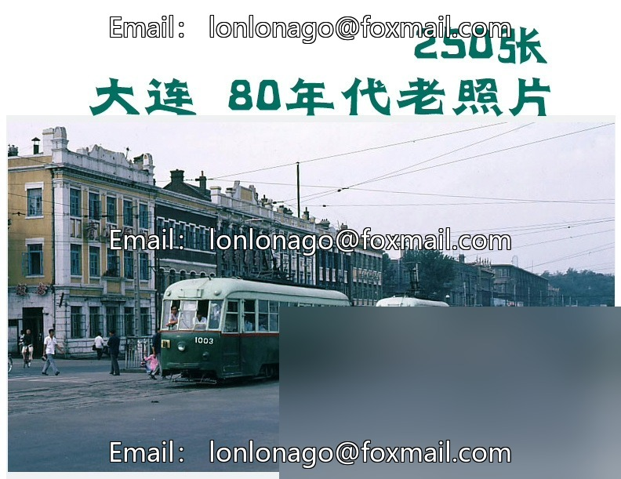
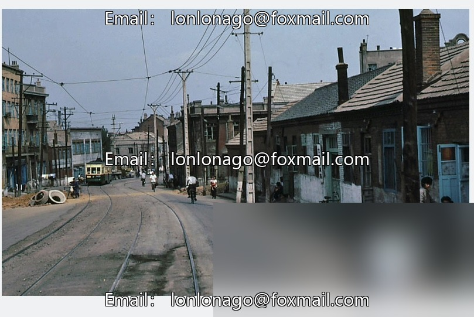
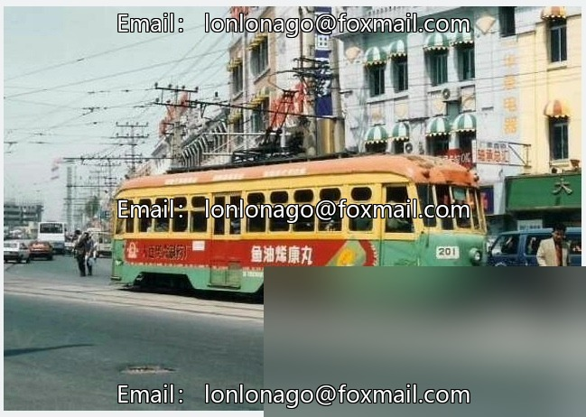
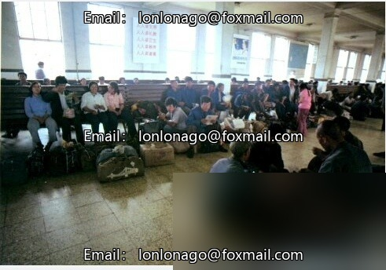
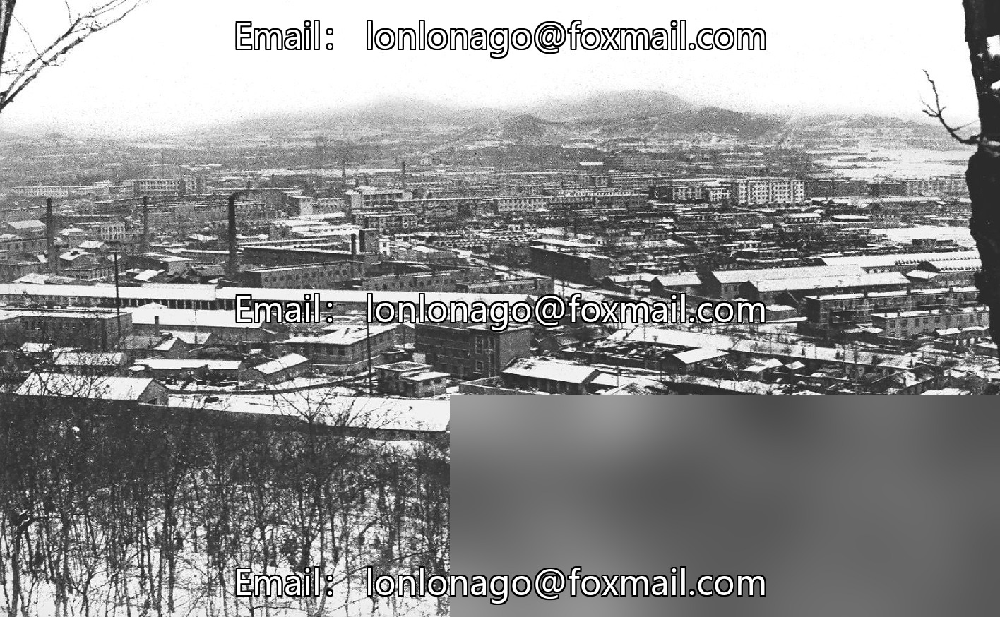
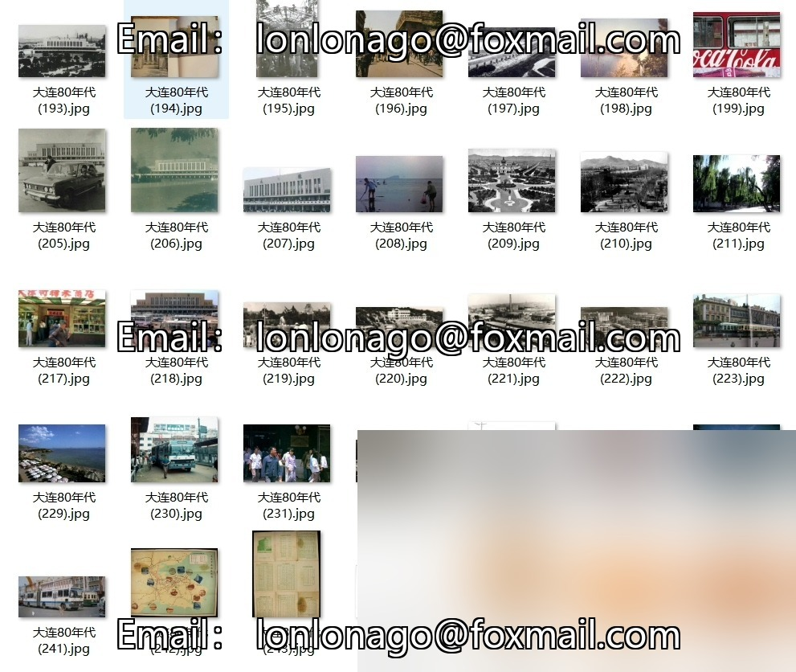
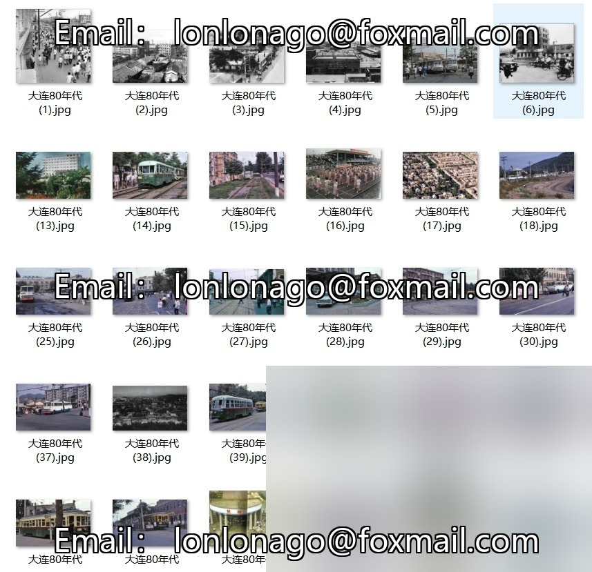

# Dalian old photograph image , old photographs of the 1980s have a sense of era, including people, cities, and life.

## Body

Dalian old photograph image collection 80s old photographs have a sense of era. Someone with a person City Lifestyle and other scenes A total of 250 Memories of Dalian. Due to long ago The equipment is limited. So image clarity is generally not good. Please note! Please be aware before purchasing!

shared via online platform, can be directly purchased.
Available online, shipped immediately.

The collection features 80s era photos with nostalgic feel, including people, cities and life scenes, totaling 250 images; image clarity is generally low.

<!-- AI_ENRICHED -->

## Images

## Payment

Here is a pay link on Stripe ( https://buy.stripe.com/3cs8yP7sY87d0vu9AB ). Please contact me lonlonago@foxmail.com after funding $89, and I will send you a complete data files , thank you!

